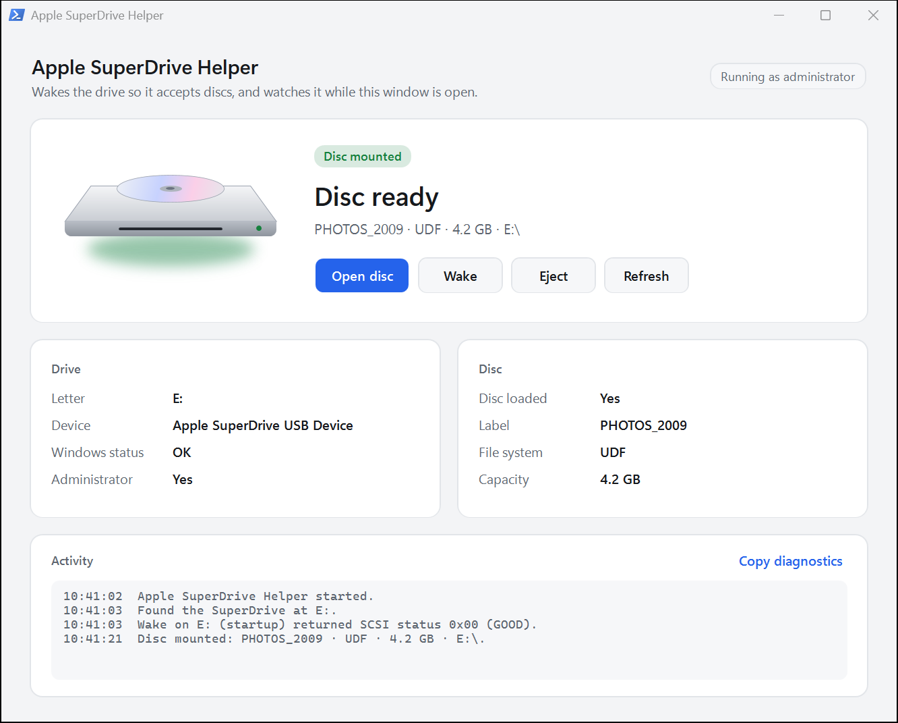
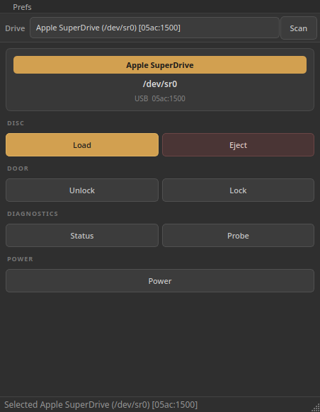

# Apple SuperDrive Helper

Wakes an Apple USB SuperDrive on Windows and Linux so it accepts discs.

<picture>
  <source media="(prefers-color-scheme: dark)" srcset="docs/gui-dark.png">
  
</picture>

On Windows and Linux the SuperDrive shows up as an ordinary optical drive, but it will not take a disc until it receives a vendor-specific SCSI command, `EA 00 00 00 00 00 01`. macOS sends that command automatically. Windows and Linux do not, and the drive needs it again every time it is plugged in. The tools in this repository send it and add controls for ejecting and opening discs.

| Platform | Use |
| --- | --- |
| Windows | `AppleSuperDriveGui.cmd` (window) or `Enable-AppleSuperDrive.cmd` (command line) |
| Linux | the `superdrive-helper` Python package, or the standalone installer in `linux/` |

## Windows

Tested on Windows 11. Nothing needs to be installed. Download or clone the repository and keep the Windows files in one folder, because both scripts load `SuperDriveNative.cs` from the folder they run from.

### Window

Double-click `AppleSuperDriveGui.cmd` and accept the administrator prompt. Windows only lets administrators send the wake command. If you decline the prompt, the window still opens and shows the drive's status, but it cannot wake the drive.

The window wakes the drive when it opens and again each time the drive is plugged back in. It shows the drive's current state with the next step as the main button: wake the drive, insert a disc, or open the disc in File Explorer. The other buttons are Wake, Eject, and Refresh (F5). If the drive rejects the wake, the window shows the SCSI status and sense code it returned.

Copy diagnostics puts the drive details and recent log on the clipboard for a bug report. The full log is in `%LOCALAPPDATA%\AppleSuperDriveHelper\gui.log`.

### Command line

```powershell
.\Enable-AppleSuperDrive.cmd
.\Enable-AppleSuperDrive.cmd -DriveLetter E
```

This asks for administrator rights, wakes every connected SuperDrive (or only the one at `-DriveLetter`), prints `Awake` or `Rejected` for each, and waits for Enter before closing.

For scripts, run it from an elevated PowerShell. It exits with code 1 if no SuperDrive is found or any drive rejects the wake.

```powershell
powershell.exe -NoProfile -ExecutionPolicy Bypass -File .\Enable-AppleSuperDrive.ps1 -DriveLetter E
```

## Linux

There are two Linux versions. Both wake the drive; they differ in how they install and what else they do.

- **`superdrive-helper` package** (`superdrive/`): a GUI and a CLI installed with pip. It talks to the drive through sg3-utils and can also lock the drive during a burn and keep its USB port powered. Automatic wake on plug-in is an optional udev rule.
- **Standalone installer** (`linux/`): one script that sets up automatic wake on plug-in, a Wake button that needs no password, and a window that matches the Windows version. The helper uses only the Python standard library. It has not been tested with a real drive yet.

Both install a udev rule at `/etc/udev/rules.d/99-apple-superdrive.rules`, so install one or the other.

To wake the drive once by hand with sg3-utils:

```bash
sudo sg_raw /dev/sr0 EA 00 00 00 00 00 01
```

### superdrive-helper package

Install from the repository root:

```bash
sudo apt install sg3-utils
python -m pip install .
```

Or with conda:

```bash
conda env create -f environment.yml
conda activate superdrive
sudo apt install sg3-utils   # not on conda-forge
python -m pip install .
```

Most Linux systems require your user to be in the `cdrom` group to access `/dev/sr0` directly:

```bash
sudo usermod -aG cdrom "$USER"
newgrp cdrom
```

#### GUI



Run `superdrive-helper`. The buttons are:

- **Load** sends the wake command. It is enabled only for a drive with USB ID `05ac:1500`.
- **Eject** unmounts the disc if it is mounted, then ejects it.
- **Lock** and **Unlock** set and clear SCSI Prevent/Allow Medium Removal, so the disc cannot be ejected during a burn.
- **Status** checks whether the drive is ready. **Probe** shows its INQUIRY, VPD, and mode data.
- **Power** disables USB autosuspend for the drive's port. It needs root and resets when the drive is unplugged.

#### CLI

Read-only commands run directly:

```bash
superdrive-cli device list
superdrive-cli device status --device /dev/sr0
superdrive-cli device probe  --device /dev/sr0
```

Commands that change the drive's state require `--yes` or `--dry-run`, so a script cannot change it by accident:

```bash
superdrive-cli device load  --yes --device /dev/sr0
superdrive-cli device eject --yes --device /dev/sr0
superdrive-cli device lock  --yes --prevent --device /dev/sr0
superdrive-cli device lock  --yes --allow   --device /dev/sr0
```

Add `--json` for structured output on stdout. Errors go to stderr as `{"error": {"message": ..., "hint": ..., "details": {...}}}`. `superdrive-cli schema describe --json` prints the full command contract.

| Exit code | Meaning |
| --- | --- |
| 0 | Success |
| 1 | Operation failed |
| 2 | Bad input or configuration |
| 3 | Device not found |

#### Automatic wake

To wake the drive whenever it is plugged in, install the udev rule and replug the drive:

```bash
sudo cp udev/99-apple-superdrive.rules /etc/udev/rules.d/
sudo udevadm control --reload
```

The rule sends the wake command with `sg_raw` and disables USB autosuspend for the drive.

### Standalone installer

```bash
sudo bash linux/install.sh
```

This installs:

- `/usr/local/lib/apple-superdrive-helper/superdrive.py`, the command-line helper (Python 3 standard library only)
- `/etc/udev/rules.d/99-apple-superdrive.rules`, which matches the SuperDrive's USB ID `05ac:1500` and, on systemd systems, starts `apple-superdrive-wake@.service` to wake it
- a polkit policy that lets the logged-in user wake the drive from the window without a password
- the window, an `apple-superdrive-helper` launcher, and a "SuperDrive Helper" menu entry

The window needs PySide6. Install it from your distribution (`python3-pyside6.qtwidgets` on Debian and recent Ubuntu, `python3-pyside6` on Fedora, `pyside6` on Arch), or add `--venv` to install it from PyPI into a private virtual environment.

| Option | Effect |
| --- | --- |
| `--venv` | Install PySide6 from PyPI if the system does not have it |
| `--no-gui` | Install only the automatic wake and the command-line helper |
| `--uninstall` | Remove everything the installer added |

Plug in the drive. It is woken within a second or two. To see the result:

```bash
journalctl -u 'apple-superdrive-wake@*'
```

Open SuperDrive Helper from the applications menu, or run `apple-superdrive-helper`. The window follows the desktop's light or dark theme and logs to `~/.local/state/apple-superdrive-helper/gui.log`.

From a terminal:

```bash
helper=/usr/local/lib/apple-superdrive-helper/superdrive.py
$helper status            # add --json for machine-readable output
sudo $helper wake
$helper eject
$helper open              # mounts the disc if needed and opens it in the file manager
$helper wake --device /dev/sr1
```

Without `--device`, `wake` and `eject` act on every connected SuperDrive and `open` uses the first one.

Waking needs root because Linux only passes vendor-specific SCSI commands from processes with `CAP_SYS_RAWIO`. When started through pkexec, the helper accepts only `wake`, and only for a device whose SCSI inquiry identifies it as an Apple SuperDrive.

To run the window from a checkout without installing, use `python3 linux/superdrive_gui.py`. Without the polkit policy, waking the drive asks for your password.

## Troubleshooting

- Plug the drive directly into a USB port on the computer, without a hub or adapter, when you can.
- If the wake is rejected, try another USB port or cable, then wake the drive again.
- If the drive accepts the wake but still refuses discs, the remaining causes are power, the cable or adapter, or a mechanical fault.

## Development

The `superdrive-helper` package:

```bash
pip install -e ".[dev]"
ruff check .
pytest -q
```

The standalone Linux helper:

```bash
python3 -m unittest discover -s linux/tests
```

These tests cover the code that does not need a drive: the `sg_io_hdr` layout, sense decoding, drive discovery on a fake sysfs tree, mount and udev parsing, wake records, and what the window shows in each state. The window tests are skipped when PySide6 is not installed.

The Windows scripts have no automated tests.

## License

MIT. This is an unofficial tool and is not affiliated with Apple.
